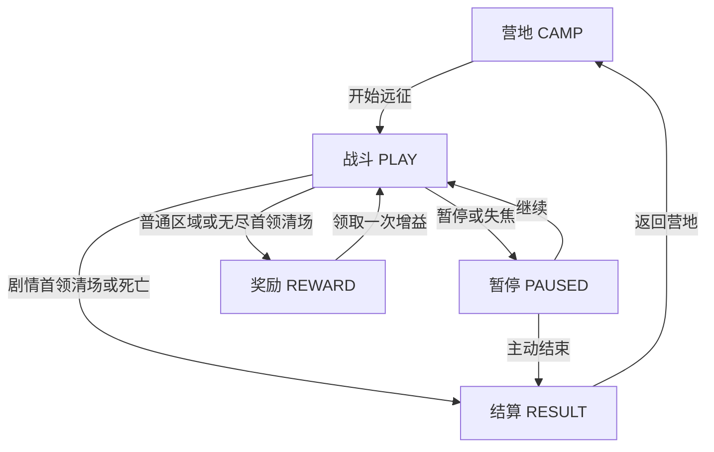

# 灯下归途开发指南 · 0.9.0 无尽远征

本指南对应 `demo` 分支的原生 Android 即时动作版。应用版本为 `0.9.0-endless`（versionCode 11），存档协议为 v10。旧回合制原型保留在 `main`，也保留部分核心源码供参考；开发动作功能时从 `ActionGame` 和当前 Activity 入口开始。

## 1. 开始开发

本机环境以仓库配置为准：JDK 17、Android SDK 35、Build Tools 35.0.0。应用最低 Android 8.0（API 26），targetSdk 35，横屏、离线运行。

```bash
# 仓库根目录：纯 Java 核心回归，不需要 Android SDK
bash scripts/test-core.sh

# 安装 Android SDK 后：静态检查、主 APK、测试 APK
bash gradlew lintDebug assembleDebug assembleDebugAndroidTest --no-daemon

# 已启动并连接测试模拟器时：会安装 APK 并写测试存档
bash scripts/emulator-smoke.sh
```

Android Studio 可以直接打开仓库。主包输出为 `app/build/outputs/apk/debug/app-debug.apk`；测试包位于 `app/build/outputs/apk/androidTest/debug/`。模拟器脚本用于专用测试设备，会操作三个手动槽，不要直接在存有个人进度的设备上运行。

开发先在 `demo` 汇总变更、检查、提交，再查看对应提交的 CI。当前工作流已包含构建与 API29 模拟器，不需要为每项功能新建工作流。纯文档提交可使用 `[skip ci]` 提交标记；玩法、存档、Android 代码或构建配置变更应执行相关验证。

## 2. 代码入口与职责

下表路径相对于 `app/src/main/java/io/wayfarer/rpg/`，测试另列。当前定义主要是 Java 数组和分支，尚不是 JSON 内容加载框架。

| 需求 | 入口 | 职责 |
|---|---|---|
| 动态难度与药瓶概率 | `core/ThreatSystem.java` | 进入区域时定值，清场更新下一场压力，敌人类型掉率 |
| 战斗、移动、流程、结算 | `core/ActionGame.java` | 全部实际游戏规则，保持 Android 无关 |
| 角色配置与技能树 | `core/BuildSystem.java`、`CharacterWorkshop.java` | 定义、前置校验、外观与配置草稿 |
| 职业、专精、背景 | `core/CareerSystem.java`、`CareerHall.java` | 11职业、22专精、6背景；普通能力无需灵魂 |
| 职业禁术 | `core/ProfessionPacts.java` | 8种可选越界能力的文案、代价和冷却；效果由核心执行 |
| 灵魂 | `core/SoulSystem.java`、`SoulAltar.java` | 光辉/禁忌变体与魂技选择 |
| 圣遗物 | `core/RelicSystem.java`、`RelicCabinet.java` | 收藏、双槽装配与条目定义 |
| 敌群与追击说明 | `core/EncounterSystem.java` | 稳定敌人ID、五区组合、应对说明、三种追击文案 |
| 世界、主线、人物 | `core/WorldSetting.java`、`core/StorySystem.java` | 1887灰桥地点、剧情文本与结局判定 |
| 剧情交互 | `StoryJournal.java` | 原生可滚动对话、读取进度、提交一次性选择 |
| 存档协议 | `core/ActionSave.java` | 编码、严格校验、版本迁移 |
| 磁盘与生命周期 | `SaveStore.java`、`MainActivity.java` | AtomicFile、菜单、后台暂停、保存与恢复 |
| 画面与触控 | `WorldView.java` | Canvas、镜头、预警、触点、帧循环、表现信号 |
| 音效 | `GameAudio.java` | SoundPool 播放与短音效 |
| 核心回归 | 仓库 `tests/*.java` | 行为、组合、迁移与非法状态验证 |
| Android 回归 | `app/src/androidTest/java/io/wayfarer/rpg/SmokeInstrumentation.java` | 真实 Activity、触控、原生菜单、AtomicFile 与截图 |

规则不能依赖 Canvas、Activity 或磁盘；界面调用核心接口，再保存和刷新。`signal(...)` 用于声音、数字和动画，不能作为唯一的伤害或奖励来源。

## 3. 时间、坐标与流程

世界范围为 **1120×760**，显示逻辑坐标为 **960×540**。`WorldView` 按屏幕等比缩放并留边，触点先反算显示坐标；世界中的敌人位置和按钮位置不属于同一坐标系。调整界面时同步检查 `uiTap`、战斗触点区域和模拟器点击坐标。

Choreographer 驱动固定 `1/60` 秒模拟，每帧最多补五步；核心 `update` 还将单次 dt 限到 0.05 秒。后台不补算离线战斗。当前规则与保存均在主线程执行；若以后异步保存，先在主线程取得独立快照字节，不能让工作线程遍历正在变化的敌人列表。



领取奖励后仍在当前区域，`roomCleared=true` 才允许走出口；左右出口分别提供恢复/资源，之后都进入顺序上的下一区。`abandon()` 只在暂停状态结算，`returnCamp()` 只接受结算状态。需要回营的测试或新界面应调用这些流程接口，不应靠直接改 `mode` 伪造结算。

战斗计时只在 PLAY 推进，命中停顿 `hitStop` 也会暂缓规则更新。暂停、奖励选择与结算冻结计时。左摇杆和持续攻击分别管理 pointer ID；取消触摸、失焦、暂停和换场清除输入，避免松手后继续攻击。

## 4. 角色、职业和永久成长

`hero` 是武器索引；自定义角色的主动技能由 `profile().skill` 单独决定，使用 `skillStyle()` 读取，不要以武器推断技能。`buildId()` 为稳定角色身份：0—2是预设，3—5是三个自定义槽。预设经验在 `experience`，自定义经验在 Profile；各自天赋、职业、灵魂、遗物和人物决定独立保存。

| 状态范围 | 主要字段 | 扩展时注意 |
|---|---|---|
| 共享永久 | `bank`、`power`、`vitality`、`relicOwned`、主线选择 | 开始远征不能清空；重复阅读或结算不能重发奖励 |
| 每角色永久 | 经验、`talents`、`careers`、`careerPacts`、灵魂配置、`relics`、人物经历 | 统一使用 buildId；切角色不能串用配置 |
| 本轮增益 | `loot`、`damageBonus`、`healthBonus`、`speedBonus`、遗物本轮触发记录 | 进入新区域继续有效，回营/新远征按规则重置 |
| 战斗临时 | 追击窗口、护盾、诅咒、危险区、冷却与周期效果 | 需要明确清理时机、暂停行为及快照恢复 |

新增天赋需同时修改 `BuildSystem.NODES`、学习/互斥校验、核心实际效果、树形布局和保存数量边界。当前是12节点、每类各选一终阶（三类可同时选），最多18点；只在界面加节点并不会获得可保存的技能树。

职业与背景分别在 `CareerSystem` 定义，专精门槛为160经验。普通职业能力、可选职业禁术和灵魂系统是三套独立配置。禁术默认关闭，玩家确认后才启用；“禁忌”主题体现为能力对目标做出的越界行为，数值代价是另一项平衡规则。新增职业还要更新人物文本、职业校验和快照中职业来源的上限，不能只扩充选择列表。

增加第四个预设或第四个自定义槽时，必须一起扩展所有按3/6分配的矩阵、buildId映射、编辑器、保存循环与迁移。当前不是任意数量角色的通用注册系统。

## 5. 技能与伤害扩展

### 二段技能

`skill()` 发动初段并打开 `followUpWindow=followUpDuration()`（普通2秒，回环3秒）；在冷却未结束且窗口有效时，再次调用会进入 `followUp()`。一次追击后窗口归零，第三次点击不能免费再发；错过窗口不返还冷却。技能冷却被奖励或职业能力重置时，也要同步处理窗口。

| 技能样式 | 追击 | 主要规则 |
|---|---|---|
| 0 震地 | 断层追击 | 320距离；1.3倍伤害，对仍眩晕的目标1.95倍 |
| 1 散射 | 破盾点射 | 640距离；先清目标护盾，再造成1.8倍伤害 |
| 2 环刃 | 穿影突刺 | 最多180位移；逐步碰撞检测，1.5倍伤害，对蓄力目标2.1倍，短暂无敌0.18秒 |

追击遵守视线；突刺碰墙停下。光辉追击命中补8辉盾（总上限30），并净化自身110范围弹丸；禁忌追击支付2%最大生命、增加12侵蚀，命中既有诅咒时消耗它并造成附近次生伤害。机械师禁术生效时，追击还检查额外4%生命支付，无法支付必须在任何变更前拒绝。

修改追击时同步检查 `skill` / `followUp`、`EncounterSystem.FOLLOWUP_DETAILS`、`StoryJournal`手册、按钮/预警表现和 `ActionSave` 窗口边界。新增第四种技能还涉及 Profile 校验、编辑器选项、初段与追击分派、灵魂变体及版本迁移。

### 命中路径和触发资格

普攻近战使用攻击弧、视线和每次挥击命中集合；投射物使用上一位置到当前位置的线段检测。穿透弹保存已命中ID，恢复后不能重复打同一目标。初段震地/环刃和灵魂领域沿用范围判定，可穿过小障碍；追击、普通近战、投射物和光矛分别遵守现有遮挡规则，扩展时不要假定所有范围技一致。

| 核心入口 | 当前用途 |
|---|---|
| `hit(e, value)` | 有效玩家攻击，允许普通命中收益与符合条件的职业/遗物效果 |
| `hit(e, value, false)` | 次生伤害，关闭普通命中回能和相关传播资格 |
| `hit(e, value, charge, echoEligible)` | 特殊路径分别控制回能/血契吸血资格和职业/回响触发资格 |
| `hurt(value)` | 敌方对玩家造成伤害，经减伤、护盾、受击保护和死亡处理 |
| `payForbidden(...)` / `payPact(...)` | 不同来源的自我支付；不要改为受击以免触发反震/回能 |

`hit` 内部仍有诅咒修正、敌方护盾吸收和死亡连锁等共享逻辑；`false` 不表示绕过全部效果。只有实际造成生命伤害的有效攻击才获得对应命中收益。扩展传播、反弹或处决时，明确“原始攻击/次生伤害/死亡触发”的边界，并测一次命中不能无限回能、复制伤害或重复兑现。

## 6. 侵蚀与周期状态

侵蚀在 `payForbidden()` 增加，在 `updateSoul()` 推进。初段+18、追击+12、魂技+30，上限100；每次禁忌施法将消退等待重置为8秒，等待结束且血契/领域均结束后，每秒消退1点。普通攻击不重置等待。

50/75侵蚀分别给予15%/25%输出增幅。达到100触发6秒失控，失控期间使用40%输出增幅；每1.5秒流失3%最大生命。以上侵蚀输出档位互相替代，不叠成80%；其他构筑增伤仍按各自公式组合。原有每点侵蚀提高承伤0.4%、降低治疗0.3%的规则保留。

`ruptureTime` 是失控剩余时间，`ruptureTick` 是下一次生命脉冲时间，`ruptureLatched` 防止持续停在100反复触发。失控结束且侵蚀低于70才解除锁。自我流失不致死，也不能把原本不足1的生命补成1。

调节侵蚀时应使用真实冷却和施法验证阈值可达：不能只手工写入100来证明机制正常。`ChallengeTests.erosion()` 已包含连续四轮初段+追击、自然冷却、停用消退、暂停和同相位恢复。增加周期状态时保存“剩余持续时间”和“距离下一次脉冲”，读档不能从第一个脉冲重演。

## 7. 敌人 AI、首领和危险区

| 稳定 type | 敌人 | 当前行为 |
|---|---|---|
| 0 | 失魂工人 | 近身挥击、交错接近 |
| 1 | 封锁枪手 | 锁定瞄准、近身后退、两轮三发扇射 |
| 2 | 冲撞搬运工 | 蓄力后直冲，另有恢复状态 |
| 3 | 失魂监工 | 三招式轮换，半血提速，首领控制/处决抗性 |
| 4 | 追猎者 | 绕侧、预测移动趋势后锁定突进 |
| 5 | 焚灯者 | 预判落点、两片延迟燃烧区 |
| 6 | 敲钟人 | 给附近其他敌人补盾、扇射 |

`updateEnemy()` 是行为入口，`aimEnemy()` 在蓄力开始记录方向与落点。state 0接近、1蓄力、2攻击/恢复；2和4型还使用state 3作为冲刺后的恢复期。`struck` 分别防止冲锋重复伤害或重复发出第二轮齐射。不要只读 Enemy 字段旁的旧简注来推断完整状态机。

监工 `pattern` 0为近身冲击区+环射，1为两轮定向齐射，2为三个错时落点。每轮恢复结束再切换pattern，半血改变节奏。敌方 `guard` 上限40，敲钟人每次给予其他友军24；破盾追击可移除。拳击手毁伤通过 `enemyForce()` 影响实际攻击力，新敌方攻击也应接入该路径。

`Hazard` 保存 `type/x/y/radius/warning/life/tick/damage`：type 0为持续火区，1为短时冲击。预警阶段不能伤害，生效阶段才检测半径和视线；当前脉冲间隔0.65秒。清场、新房间和回营清理危险区。

新增敌人的完整步骤：

1. 在 `EncounterSystem.NAMES/COUNTERS` 末尾追加ID，更新需要的 `GROUPS`，保留0—6含义。
2. 在 `generateRoom()` 设置生命和出生条件；在 `updateEnemy()` 增加接近、预警、出手、恢复及必要字段。
3. 在 `WorldView` 更新敌人外观和预警，使方向、落点、半径与实际伤害一致。
4. 更新 `ActionSave` 的type/state/计时/新字段边界并增加显式版本迁移；新增状态不能塞进不相容的旧字段。
5. 验证出生合法、躲开预警有效、站在攻击区确实受伤、暂停/读档不重放，以及眩晕、护盾、诅咒和职业禁术的组合。

当前无通用敌人定义注册表，增加数组名称不足以生成新行为。危险区最多18、敌人快照最多40、投射物最多160；这些是当前实现/校验约束，不是自动支持任意数量的承诺。提高上限时同时考虑渲染、模拟和128 KiB存档预算。

## 8. 房间和难度调校

五区使用固定类型组合、随机合法位置和障碍。`rngState` 保存确定性随机状态，布局检查覆盖80种子×5区域。中央路径和出口区需保持可通行；复杂迷宫应另行实现导航，而不是在绘制时给每个敌人搜索整张地图。

调难度优先调整混编、攻击间隔、预警时长、封路位置和恢复机会，再调整生命/伤害。预判应在预警开始锁定，不能在攻击瞬间悄悄重新瞄准。保持玩家可观察、可反制的窗口。

`ChallengeTests.pressure()` 用12个种子测试20秒基础绕圈，不攻击、不闪避；0.8.0结果为12/12受伤、平均损失57.0HP。它只验证单一策略不再轻易无伤，不代表高手无伤不可能或整体平衡已完成。更换策略或装备时另记录生存、耗时、药水和输出数据，避免只追求“测试一定受伤”。

扩展为完整地牢时，需要新增房间图、门连接、访问状态和回访奖励记录；当前左右出口只是奖励差异，主线依然顺序推进。

## 9. 主线和人物剧情

`StorySystem` 保存文本/结局判定，`ActionGame` 保存进度并发奖，`StoryJournal` 负责阅读与选择。不要在窗口打开、绘制或读档时发奖励。

| 字段 | 归属与含义 |
|---|---|
| `storyUnlocked` | 共享五位解锁标记，区域清场时设置 |
| `storyChoices[5]` | 共享主线选择，0未选、1救援、2取证 |
| `characterUnlocked[6]` | 各角色三章解锁；当前合法值0/1/3/7 |
| `characterJobs[6]` | 首次解锁时的职业来源；尚未经历为-1 |
| `characterChoices[6][3]` | 各角色各章决定，0未选、1守护、2决意 |

清场调用 `unlockStory()`：任意首次清场解锁人物旧事，三区及之后解锁裂痕，五区解锁回声。主线选择通过 `decideStory(scene, choice)`，只接受已解锁且尚未决定的条目，在PLAY期间拒绝；成功后救援给12共享票券，取证给当前角色20经验。读取已决定条目不能重发奖励。

人物选择通过 `decideCharacter(chapter, choice)`，仅限营地。守护每章+4生命上限，决意每章+1基础伤害；`characterTrait()` 参与派生属性。更换职业保留最初记录的故事起点，不替换已发生的文本来源。11职业加无职业共12套三段文本，职业禁术开关不由剧情决定。

五章主线完成后：最后选救援且救援总数至少3为「归途有名」；最后选取证且救援总数至多2为「墨迹未干」；其他为「灯下余声」。当前结局是文本分支，不生成额外地图。

修改现有章节文本可直接编辑 `TITLES/SCENES/OPTIONS`；改变已选选项的含义时必须考虑旧档，不能默默给旧选择套上相反后果。人物文本按职业ID对应 `PEOPLE/PERSONAL_OPTIONS`。

新增第六章或第四段人物故事需要同时修改数组长度、解锁条件、选择接口边界、结局、手记菜单、`ActionSave`循环与位标记范围，以及迁移和测试。当前 `StoryJournal` 菜单、五区清场和三段人物线均有固定结构，不能只追加一段字符串。将来迁移到JSON时，先引入稳定章节ID与加载校验，再替换内容来源，保留旧ID映射。

## 10. 存档协议和状态寿命

当前编码为 **`format=wayfarer-action`、`version=10`**，读取v1—v10。私有目录仍叫 **`action-saves-v1`**，这是目录名，不是协议版本；不要随应用版本改目录导致旧档“消失”。0槽自动保存，1—3为手动槽。旧回合制使用不同applicationId/格式，不能强行读取为动作快照。

`ActionSave.decode` 先恢复到新对象并校验，界面成功后才替换当前游戏。`SaveStore.write` 写盘前也执行一次解码校验，之后用AtomicFile完成写入或回滚。错误需要提示，不能静默创建空档覆盖。输入上限128 KiB，所有数量、有限浮点、坐标、模式、构筑来源和派生上限都要检查。

| 状态 | 换区域 | 回营/新远征 | 保存恢复 |
|---|---|---|---|
| 主线、人物选择、收藏、经验 | 保留 | 保留 | 不重发奖励 |
| 侵蚀、消退等待、失控相位/锁、魂技冷却 | 保留 | 重置 | 按剩余值恢复 |
| 职业禁术持续时间和冷却 | 保留；旧敌人的标记随旧房间实体移除 | 重置 | 不重复支付或抽取 |
| 追击窗口、敌人/弹丸、危险区 | 清理/重新生成；普通技能冷却也重置 | 清理/重置 | 恢复当前战斗状态 |
| 灵魂领域、辉盾、血契 | 清理 | 清理 | 当前房间剩余状态恢复 |
| 遗物本轮救命次数 | 保留 | 重置 | 不补充已用次数 |

人物选择必须先于 `hp <= maxHp()` 校验加载，否则有永久生命被动的合法存档会被误拒绝。读档取消正在播放的普通近战挥击，保留攻击冷却；追击窗口、敌方预警、投射物命中历史和周期相位另行恢复。`decode` 不负责把所有战斗快照切为暂停；Activity/WorldView恢复入口负责暂停，纯核心测试可按需要继续模拟。

迁移要点：v1为基础动作，v2角色/天赋，v3灵魂，v4遗物，v5职业/背景，v6普通职业扩展，v7旧职业禁术，v8越界禁术重做，v9追击/侵蚀失控/敌群/剧情，v10无尽/动态敌势/药瓶/每类终阶。v1—v9按旧全局互斥与16点预算校验；迁移后不重置已学天赋。旧战斗沿用原敌人生命和中性敌势，下次进区域生效新公式。v7读取后关闭旧职业禁术选择及其运行状态，因为能力含义已改变；v8选择仍保留。v8及更早没有新剧情经历，不凭经验或当前区域补发剧情奖励。

增加持久字段的顺序：定义默认值与寿命 → 升版本并编码 → 按版本解码 → 校验字段与来源关系 → 测旧档迁移/当前往返/非法值 → 验证暂停及房间切换。不要仅放宽旧版本的数值上限来掩盖迁移测试失败；旧格式测试应使用旧版本真正能产生的字段值。

自动保存发生在每15秒、流程/房间切换、暂停、失焦和切后台，以及配置/剧情提交等入口。系统瞬间结束进程仍可能丢失最近一次成功保存之后的进度。新建档案重置自动档案内容，但保留三个手动槽；卸载会删除私有存档，目前没有云同步或存档导入导出。

## 11. 画面、声音与 Android 验证

当前是Canvas原创占位角色和工业场景。替换为图集时预加载资源，保持碰撞与图形分离，避免在 `onDraw` 读取磁盘。装饰轨道、管道不自动产生碰撞；预警形状应从实际规则字段读取。完整动画、配音、可行走NPC、手柄和TalkBack逐控件导航仍需后续实现。

新增Signal类型时在 `WorldView.consumeSignals()` 接入表现，必要时映射 `GameAudio`；没有音效映射不应影响技能执行。多次范围命中注意音效叠加与表现列表开销。

| 修改范围 | 主要回归 |
|---|---|
| 移动、普攻、关卡、结算 | `ActionTests`；旧核心 `CoreTests` 保留 |
| 自定义角色与技能树 | `BuildTests` |
| 灵魂、侵蚀、领域 | `SoulTests` + `ChallengeTests` |
| 圣遗物 | `RelicTests` |
| 职业、背景、专精 | `CareerTests` |
| 越界禁术及组合 | `PactTests` |
| 追击、新AI、主线/人物、v9 | `ChallengeTests` |
| 无尽、动态敌势、三终阶、药瓶与v10 | `EndlessTests` |
| 按钮、对话、真实写盘 | `SmokeInstrumentation` |

新功能应验证结果：目标生命、护盾、真实扣款、一次性奖励和下一次脉冲，而不只检查字段“已打开”。修改复杂行为后运行完整核心脚本；UI改动再做Android静态检查和模拟器交互。纯文档维护只需核对引用、符号、命令和版本，不必重建APK。

原生AlertDialog按钮回调是异步处理的，Instrumentation应等待回调与界面空闲后再断言；切换确定性测试场景时清理不属于该场景的命中停顿。不要把测试配置误标成自然通关：23/24为加速清场后的剧情界面，25用合法施法累积100侵蚀但冻结远处测试敌人，26为预设位置后由实际AI产生的危险区和护盾。

0.8.0已通过核心回归、lint、APK构建和API29模拟器，记录见[对应CI运行](https://github.com/t192107011-rgb/wayfarer-rpg-kit/actions/runs/40164297760)。这不是后续任意修改的验收凭据；真机触控手感、性能和长期平衡仍需另外验证。

## 12. 分支、签名与复用

`demo`用于当前开发，`main`保留旧版。汇总实现和检查后一次提交，检查Actions的提交SHA，避免下载到另一版本的产物。已有工作流会响应代码推送；不要无故重复手动触发。

长期分发应使用固定私有签名并备份密钥，通过安全的构建配置注入。不要提交keystore、密码、本机SDK路径或生成的APK。当前CI使用临时debug签名；**应用ID相同、存档格式兼容，并不足以保证覆盖安装**。本次0.8.0与上一版0.7.1签名不同，无法直接覆盖；不能以卸载旧版作为保留进度的升级方案。签名策略及存档迁移/导出需要作为专门功能实现和验证。

复制为全新作品时，可以更换applicationId、namespace、Java包名、名称、图标和存档标识，重新维护第三方许可说明；如果是已有应用的更新，则保持安装身份与保存路径，按版本迁移。复用前阅读仓库 `AGENTS.md` 和现有测试。

## 进一步阅读

- [0.9.0无尽、敌势与流派规则](ENDLESS.md)
- [0.8.0战斗与剧情规则](BLACK_BELL.md)
- [角色配置与天赋](CHARACTER_BUILDS.md)
- [职业、专精与背景](CAREERS.md)
- [职业禁术](PROFESSION_PACTS.md)
- [灵魂机制](SOULS.md)
- [圣遗物](RELICS.md)
- [1887灰桥设定](SETTING.md)
- [测试范围与截图说明](TESTING.md)
- [版本变更记录](CHANGELOG.md)

## 13. 无尽、动态敌势与掉落扩展

当前完整数值和组合见[ENDLESS.md](ENDLESS.md)。`startEndless(seed)`与`start(seed)`共用受营地状态保护的入口；`advanceRoom()`在无尽中推进层数并映射到1—5区域。无尽首领进入REWARD，剧情首领进入RESULT。`bestDepth`只在清场增长、永久保留；`endlessDepth`、压力和本轮增益在回营/新局重置。

`ThreatSystem.enter`先计算敌势和属性下限，再生成敌人；`enemyRange`同时供命中与预警使用。不得在每帧按当前生命重算敌人。`hurt`记录穿过护盾后的累计失血，自我献祭不计；`ThreatSystem.clear`只在实际清场事件调用。敌势、压力和下限随快照恢复，不能读档重掷。

药瓶用`Drop.potion`区分原金币/即时治疗。`collectDrop`满包返回false，调用方保留该掉落；清场批量收集沿用同一函数。死亡概率使用核心已保存的RNG，不能使用UI随机数。调整携带量同时改`MAX_POTIONS`、v10校验、UI与测试；保留旧版本2瓶边界。永久遗物发现标记仍按本轮区域编号，每轮至多三次。

三终阶学习与读档均由`BuildSystem`按类别互斥；旧树单独走`validateLegacyTree`。命中触发恢复/护盾应检查实际生命下降，不能仅依据目标在范围内。跨类别效果仍受原治疗限制与护盾上限，失败输入不得发奖。

核心验证：`EndlessTests`完成90层真实流程转换、8种终阶组合、24种高层灵魂组合与7500次击杀概率抽样。Android新增27—29截图分别为三终阶购买、受控清场后的第六层和满包药瓶夹具；验证真实入口、按钮与AtomicFile，不代表手动打通。每次发布以该提交CI结果为准，0.8.0通过记录不是0.9.0验收凭据。
